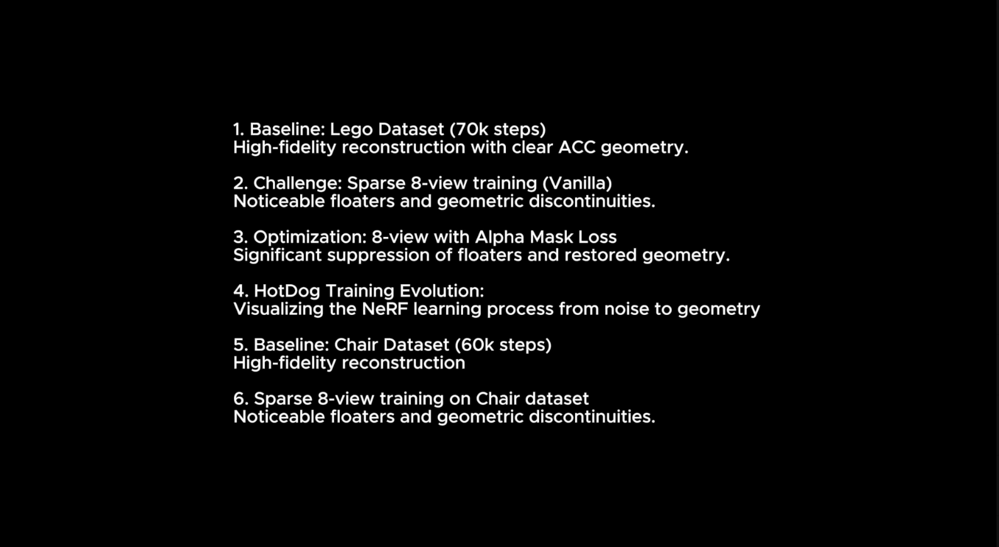
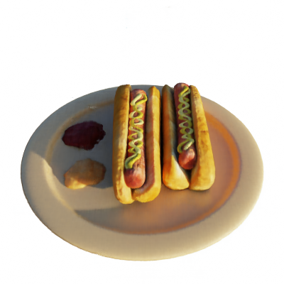

# NeRF Reproduction & Apple Silicon Optimization (IG3D Course Project)

This repository is a reproduction of the [NeRF](http://www.matthewtancik.com/nerf) (Neural Radiance Fields) method, based on the `nerf-pytorch` implementation. This project focuses on optimizing the pipeline for modern hardware (Apple Silicon) and enhancing training stability with depth supervision.

## What I did (Key Improvements)

Compared to the original paper and the base `nerf-pytorch` code, I made several modifications to make it more efficient and robust for this project:

1.  **Apple Silicon (MPS) Acceleration**:
    *   Adapted the code to support the **Metal Performance Shaders (MPS)** backend.
    *   This allows the models to train significantly faster on Mac M1/M2/M3 chips compared to running on a standard CPU.
2.  **DS-NeRF (Physical Depth Loss)**:
    *   Implemented the core idea of **DS-NeRF**: using scanned depth data to supervise the training.
    *   This helps the model converge much faster and achieve better results, especially when only a **few training views** (few-shot) are available.
3.  **Parallel Cinematic Rendering**:
    *   Developed a **multi-worker parallel rendering pipeline** (`parallel_cinematic_render.sh`) that splits rendering tasks across multiple cores.
    *   Added a specialized `render_cinematic.py` script for producing high-quality, smooth camera trajectories.
4.  **Pipeline Automation**:
    *   Included convenient scripts like `master_flow.sh` and `auto_train_v2.sh` to automate the entire process from data loading to final video generation.

## Installation

```bash
# Clone the repository
git clone [repository-url]
cd NeRF_Reproducing

# Install dependencies (Recommend using a Conda environment)
pip install -r requirements.txt
```
## Demo Video

[](https://drive.google.com/drive/home?dmr=1&ec=wgc-drive-%5Bmodule%5D-goto)

> 💡 **Online Preview**: Click the image above or [Open Demo Video on Google Drive](https://drive.google.com/drive/home?dmr=1&ec=wgc-drive-%5Bmodule%5D-goto).


## Quick Demo (Hotdog 100k)

If you are using a Mac, you can see a high-quality reconstruction of a hotdog in 30-60 seconds by running:
```bash
# Relative path from project root
bash run_hotdog_demo.sh
```
*(Result will be saved to `./logs/hotdog_100k_demo/cinematic_submission/rgb_frames/000.png`)*



## How To Run?

### 1. Training with MPS Acceleration
To train a model on a Mac using my optimized code:
```bash
python run_nerf.py --config configs/chair.txt
```
*(The code will automatically detect your Mac's GPU and use MPS acceleration)*

### 2. Training with Depth Supervision (DS-NeRF)
To use depth data (if available in your dataset) to speed up training:
```bash
python run_nerf.py --config configs/chair.txt --use_depth --depth_lambda 0.1
```

### 3. Fast Parallel Rendering
To generate high-quality cinematic videos using multiple workers:
```bash
bash scripts/parallel_cinematic_render.sh
```
*(Note: Always run automation scripts from the project root)*

After rendering, use `python tools/generate_final_video.py` to combine the frames into a final MP4.

## Project Structure
*   `run_nerf.py`: Main training script (updated with MPS and Depth Loss).
*   `render_cinematic.py`: Specialized script for high-quality camera trajectories.
*   `core/`: Core modules including data `loaders/` and coordinate `helpers.py`.
*   `scripts/`: All bash scripts for automated training and parallel rendering.
*   `tools/`: Utility Python scripts for evaluation and video post-processing.
*   `configs/`: Contains optimized parameters for different scenes (Lego, Chair, etc.).

## Citation & Credits
This project is based on the original [nerf-pytorch](https://github.com/yenchenlin/nerf-pytorch) by Yen-Chen Lin and the original NeRF paper.

```bibtex
@misc{lin2020nerfpytorch,
  title={NeRF-pytorch},
  author={Yen-Chen, Lin},
  howpublished={\url{https://github.com/yenchenlin/nerf-pytorch/}},
  year={2020}
}
```
